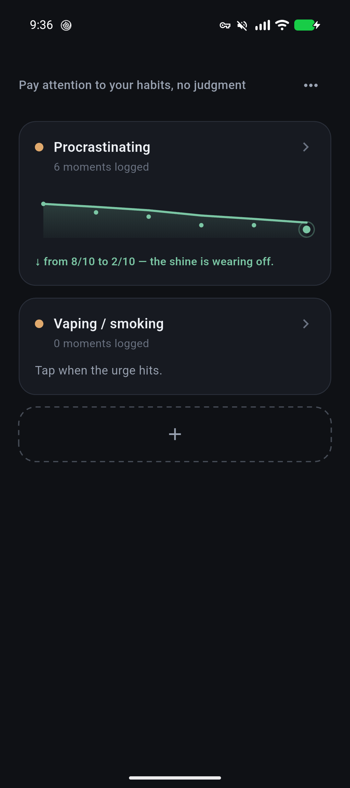
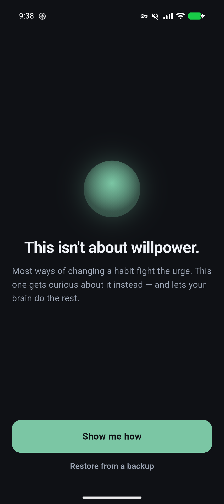
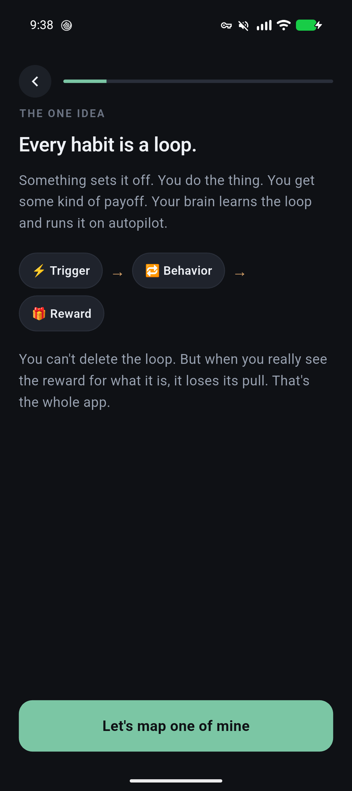
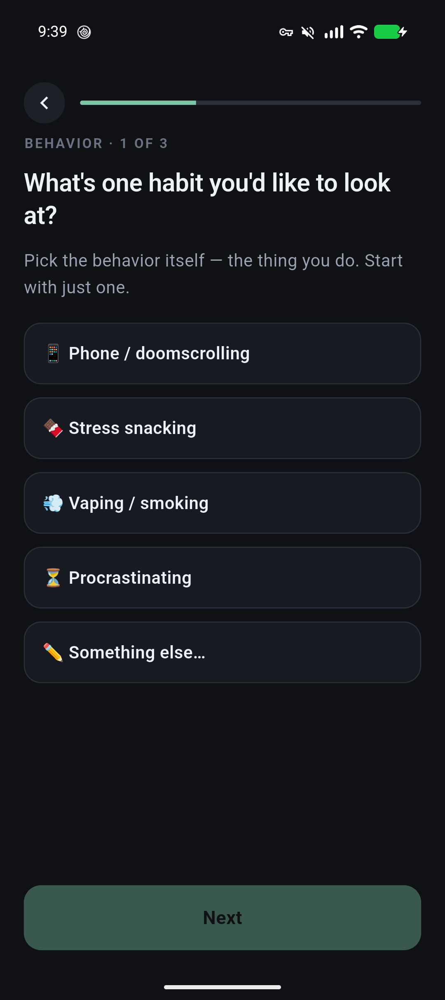
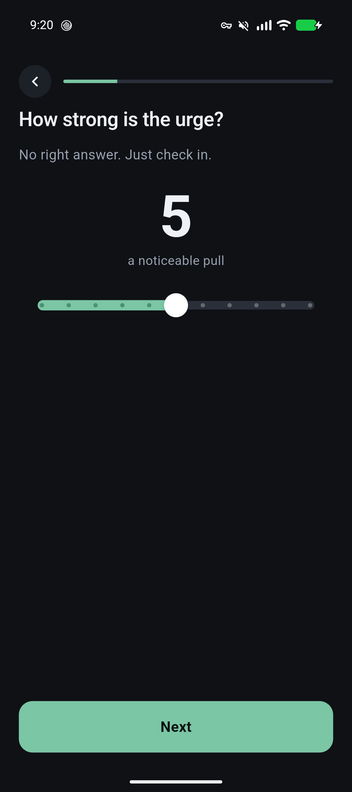
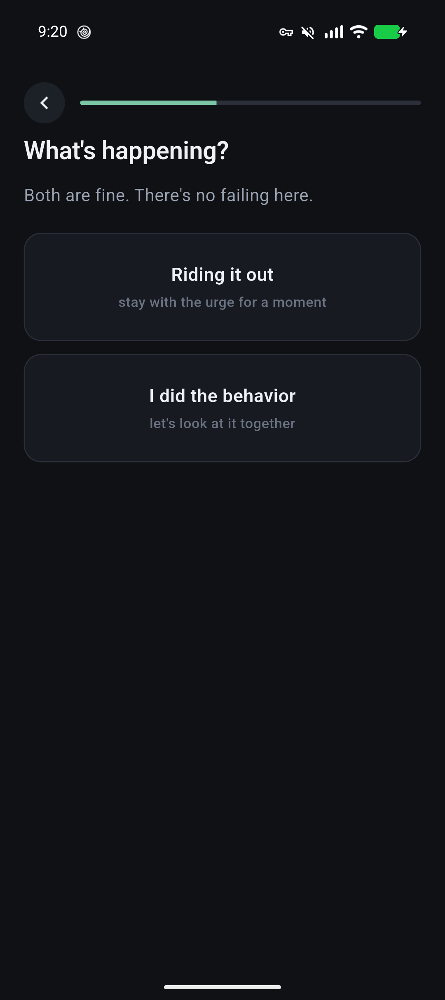
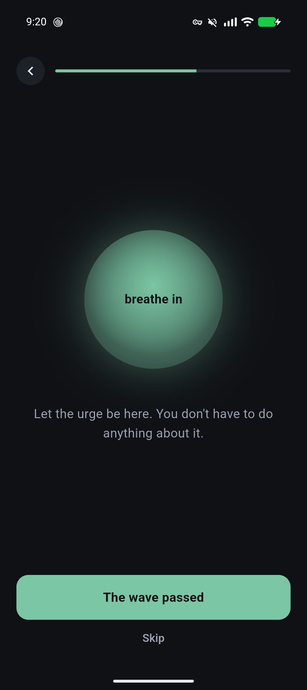
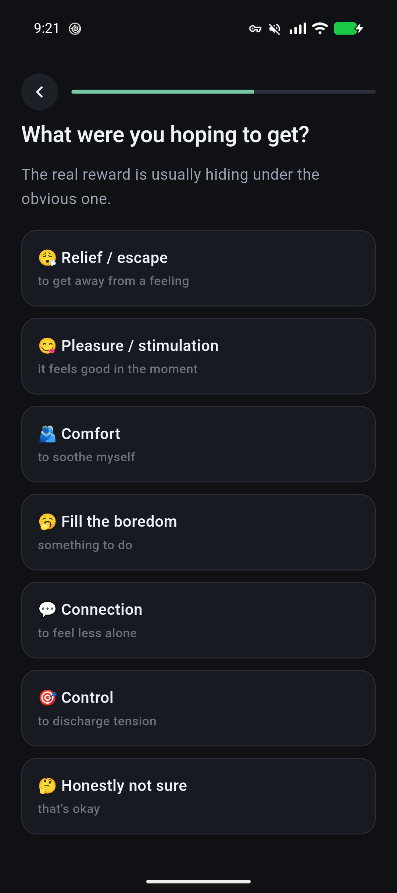
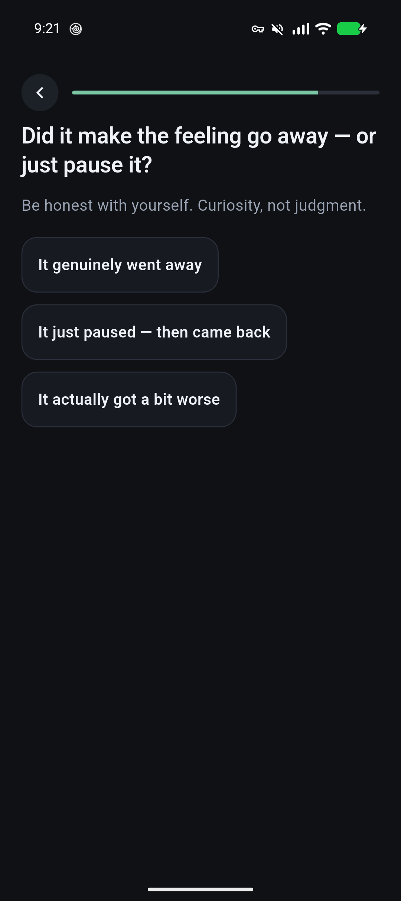
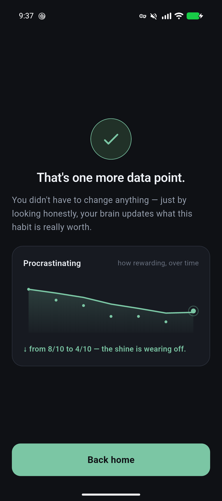

<div align="center">

# Sati

**A curiosity-based habit-change app.** Not another willpower tracker — Sati helps you change a
habit by changing how *rewarding* your brain thinks it is. You notice the urge, get curious about
what you actually get from the behavior, and watch its reward value drift down over time.

*Sati* (सति) is the Pāli word for **mindfulness / awareness** — the first step of the method.

Offline-first · private by design · open source (GPL-3.0) · Flutter (Android & iOS)



</div>

---

## Walkthrough

A full session, start to finish. (Screens below are from a debug build running on a Pixel.)

### Getting set up

<table>
  <tr>
    <td width="33%"></td>
    <td width="33%"></td>
    <td width="33%"></td>
  </tr>
  <tr>
    <td><b>This isn't about willpower.</b> Sati opens by setting the frame — you won't be fighting urges here.</td>
    <td><b>Every habit is a loop.</b> A quick idea: trigger → behavior → reward. Your brain runs it on autopilot.</td>
    <td><b>Map one loop.</b> Pick the behavior, its usual trigger, and what you <i>think</i> you get from it. Start with one.</td>
  </tr>
</table>

Onboarding ends on the counter-intuitive first instruction — **"Just notice. Change nothing."** — then hands you to Home.

### Home — the habits you're watching

<table>
  <tr>
    <td width="50%"></td>
    <td width="50%" valign="top">

A calm list of your habits. Each card shows the habit, how many moments you've logged, and its
reward-value trend once you have data. A dashed **+** card adds another habit.

- **Tap a card** → log a moment for that habit.
- **Long-press a card** → rename or delete it.
- **⋯ menu** → export or import a backup.

    </td>
  </tr>
</table>

### The Moment — the heart of the app

When an urge shows up, you open Sati and tap the habit. This is where the rewiring happens.

<table>
  <tr>
    <td width="33%"></td>
    <td width="33%"></td>
    <td width="33%"></td>
  </tr>
  <tr>
    <td><b>How strong is the urge?</b> A quick, no-judgment check-in on a 0–10 scale.</td>
    <td><b>What's happening?</b> Two equal choices, neither framed as failing: ride it out, or you already did the behavior.</td>
    <td><b>Ride it out.</b> A short breathing exercise with curiosity prompts — then you see the urge start to fade. Urges are waves, not walls.</td>
  </tr>
  <tr>
    <td width="33%"></td>
    <td width="33%"></td>
    <td width="33%"></td>
  </tr>
  <tr>
    <td><b>What were you hoping to get?</b> If you did the behavior, you pick the real reward — usually hiding under the obvious one.</td>
    <td><b>Was it worth it, really?</b> A branching, honest reflection on whether the behavior delivered what it promised.</td>
    <td><b>The reward-value trend.</b> As you log honestly, the line drifts down. That drift <i>is</i> the habit loosening its grip.</td>
  </tr>
</table>

---

## Why it exists

The approach is built on the published science of **reward-based learning** and the **habit loop**
(trigger → behavior → reward), popularized by Dr. Judson Brewer in *The Craving Mind* and
*Unwinding Anxiety*. Instead of fighting urges with willpower, you pay honest attention to the
reward — which lets the brain update what the habit is really worth (a *negative prediction error*),
so the pull fades on its own.

Sati is an **independent, original implementation of that general science**. It is **not affiliated
with, endorsed by, or derived from** Dr. Brewer or his apps (Unwinding Anxiety®, Eat Right Now®,
Craving to Quit®), and copies none of their content.

## How it works

1. **Awareness** — map your habit as a loop and name its parts.
2. **Explore the reward** — when you do the behavior, pay attention to what you *actually* get.
   Over repetitions, the brain revises how rewarding it thinks the behavior is.
3. **Ride the wave** — when you choose not to act, a short urge-surf shows the craving crest and pass.

The **reward-value trend** makes the shift visible: a line that drifts down as the shine wears off.

## Features

- **Multiple habits** — track one or many; add via a quick mapping flow, rename or delete anytime.
- **The Moment capture** — log an urge in seconds; ride it out *or* explore the reward.
- **Urge-surfing** — a guided breathing exercise with curiosity prompts and a before/after check-in.
- **Scripted reflection** — a branching, non-AI Socratic flow that helps you find the real reward.
- **Reward-value trend** — an EWMA-smoothed chart of how rewarding a habit actually is, over time.
- **Backup & restore** — export all your data as a JSON file; import it back on any device.
- **No streaks, no shame, no gamification, no social, no tracking.** A relapse is data, not failure.

## Privacy

Everything lives **on your device** in a local SQLite database. There are **no accounts, no servers,
no network calls, and no analytics.** Your only copy is the one on your phone (and any backup *you*
choose to export). This is a deliberate design choice — the data is intimate, so it stays yours.

## Tech & architecture

- **Flutter** (Dart) — one codebase for Android & iOS.
- **Drift** (SQLite) — typed, offline, local persistence.
- **share_plus** / **file_picker** — backup export & import.

```
lib/
  main.dart            app entry
  app.dart             theme + root routing (onboarding vs home)
  theme/               color system (light & dark) via a ThemeExtension
  content/             the scripted coach content (reward categories, prompts)
  data/                Drift database, trend math (EWMA), export/import, db provider
  widgets/             shared UI (buttons, chips, dashed border) + the trend chart
  screens/             onboarding, loop form, home, moment capture, add/import
prototype/             throwaway clickable HTML mockups (design reference)
docs/screenshots/      screenshots used in this README
```

Design docs live alongside the code: `APP_CONCEPT.md` · `MVP_SCOPE.md` · `CONTENT_coach-tree.md` · `DATA_MODEL.md`.

## Build & run

```bash
flutter pub get
dart run build_runner build   # generates Drift code (lib/data/database.g.dart)
flutter run                   # pick a device
flutter test                  # unit tests (trend math)
```

**Android note:** the project sets `compileSdk = 36` (in `android/app/build.gradle.kts`) and forces
all plugin subprojects to 36 (in `android/build.gradle.kts`), because a transitive plugin dependency
requires it. If you add plugins and hit an AAR-metadata `compileSdk` error, that's the knob.

## Not medical advice

Sati is a general-wellness and self-reflection tool. It does **not** diagnose, treat, or cure
anxiety, addiction, or any condition. If you're struggling, please talk to a qualified professional.

## License

[GPL-3.0](LICENSE). Derivatives must stay open source.
